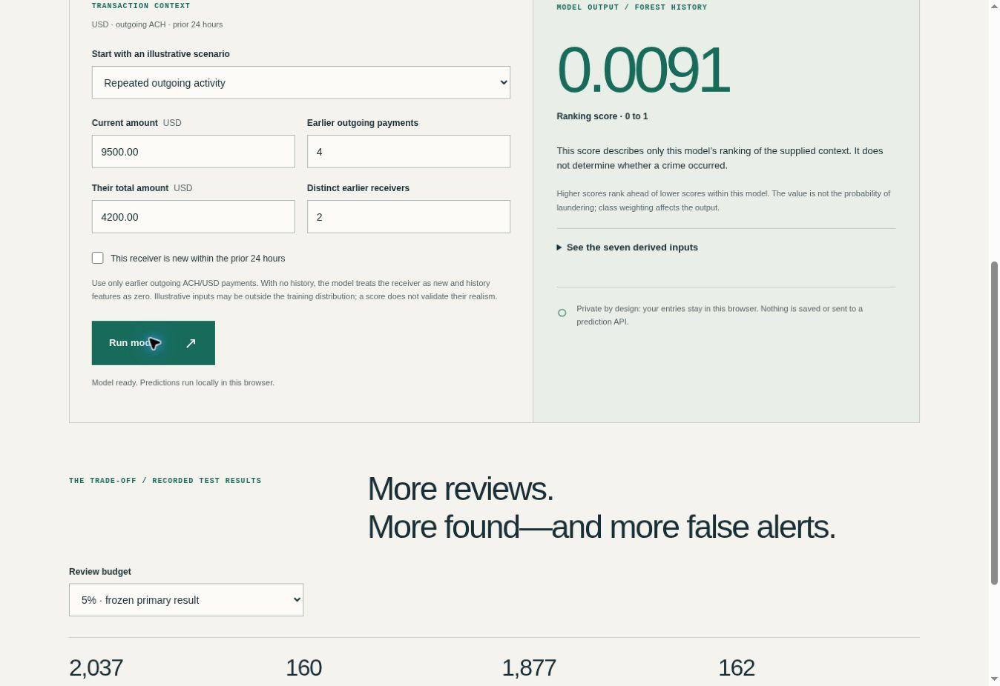

# Financial Crime Anomaly Detection

I wanted to try a small question for my first end-to-end ML project: can a sender's recent activity help rank suspicious transactions better than transaction amount alone? I used the [IBM synthetic AML dataset on Kaggle](https://www.kaggle.com/datasets/ealtman2019/ibm-transactions-for-anti-money-laundering-aml). These are simulated transactions, not real customer data.

**[Try the interactive demo](https://arash2079.github.io/ai-financial-crime-anomaly-detection/)** · [See the automated checks](https://github.com/arash2079/ai-financial-crime-anomaly-detection/actions/workflows/main.yml)



## What I've done so far

I narrowed the dataset to USD-to-USD ACH transactions from September 1–10, 2022, then built seven features using the current amount and the sender's *earlier* outgoing transactions in the previous 24 hours. I split the data by date: September 1–6 for training, 7–8 for choosing a model, and 9–10 for testing. I compared an amount-only rule, Logistic Regression, Random Forest and Isolation Forest; the supervised models also have amount-only versions. The [short data notebook](notebooks/01_data_exploration.ipynb) shows some basic plots of the prepared subset.

So far, the Random Forest using transaction history did best on validation data. On the held-out test days, it found **160 of 322** labeled transactions in the top **5%** of rows (2,037 reviewed). That is **49.69% recall** and **7.85% precision**: there were also **1,877 false alerts**. Its average precision was **0.0874**, compared with **0.0547** for the same forest using only amount. The [full comparison](results/README.md) includes the weaker models too.

I made a small browser demo to explore the selected model with made-up payment examples. It runs locally in the browser from GitHub Pages; the form does not send transactions to a prediction server. The examples are not labeled transactions and the score is a ranking score, not a probability that someone committed a crime.

## Run it yourself

Use Python 3.11+ and run these from the repository root. The dataset download is about 476 MB.

```bash
python -m venv .venv
# macOS/Linux: source .venv/bin/activate
# Windows PowerShell: .venv\Scripts\Activate.ps1
python -m pip install -r requirements.txt
python -m src.download_data
python -m src.build_dataset --input data/raw/HI-Small_Trans.csv --output data/features.csv
python -m src.train --input data/features.csv --output-dir artifacts
python -m src.export_web
python -m unittest discover -s tests -v
node --test tests/test_web.mjs
```

For the notebook plots, run `python -m pip install matplotlib` and open `notebooks/01_data_exploration.ipynb` in Jupyter or VS Code after building `data/features.csv`. Node.js 24 is only needed for the JavaScript tests. To view the site locally, run `python -m http.server 8000 --bind 127.0.0.1 --directory web` and open `http://127.0.0.1:8000`.

The download script checks the data file's SHA-256. You can also download `HI-Small_Trans.csv` from Kaggle and put it under `data/raw/`. Raw data, the prepared CSV and trained Python models stay out of Git. Only aggregate results and the exported forest used by the demo are included here.

## What's in the repo

- `src/` has the data download, feature, training and web export scripts.
- `notebooks/` has a few plots to get familiar with the prepared data.
- `data/` explains the source and filtering choices.
- `results/` has the [comparison plan](results/PROTOCOL.md), metrics and notes.
- `web/` has the demo; `tests/` has Python and JavaScript checks.

This is one experiment on a short slice of **synthetic** data. Accounts can appear on different days, I only used outgoing USD ACH history, and I have not tested how this works on real bank data or on entirely new accounts. Half of the labeled cases were still missed at the 5% review budget. I may explore other features or more time periods later, but the numbers above describe the current fixed experiment.

## Development and licenses

I used AI assistance while implementing and testing parts of this project. The code is under the [MIT license](LICENSE); IBM's dataset has its [own CDLA-Sharing-1.0 license](data/README.md).
